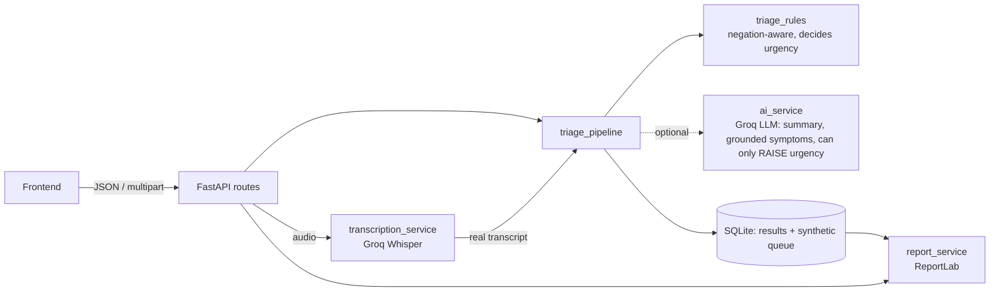

# MedTriage AI (Team Alpha 2.0, HackIndia AI & CyberTech, KIT Kanpur)

AI-assisted **triage support and documentation** prototype. FastAPI backend with text + audio symptom intake,
a transparent rules engine, optional Groq LLM/Whisper, a synthetic patient queue (SQLite) and PDF reports.

> **Hackathon prototype. NOT a medical device, NOT clinically validated, NOT a diagnosis.**
> It does not replace healthcare professionals, and no HIPAA/other compliance is claimed. Use synthetic data only.

## Architecture

Without an API key everything except audio works in a clearly labelled `rules_only` mode.

## Quick start (Windows)
```
setup.bat          :: once - venv, pip install, npm install (never overwrites .env)
notepad .env       :: add GROQ_API_KEY for AI + voice (optional)
start_all.bat      :: backend http://127.0.0.1:8000  |  frontend http://127.0.0.1:5173
```
Manual: `py -3.12 -m venv venv`, `venv\Scripts\activate.bat`, `python -m pip install -r requirements.txt`, `python -m uvicorn app.main:app --reload`;
then in `frontend/`: `npm install`, `npm run dev`. Swagger UI: http://127.0.0.1:8000/docs. Tests: `python -m pytest -q`.

## Frontend
React + Vite dashboard (`frontend/`): live clinic dashboard, text and voice intake (file upload or microphone), explained results (rule-based
urgency, absent symptoms, uncertainty, AI/rules labelling), case history, synthetic clinic queue, PDF download, and a safety page.
Set the backend address in `frontend/.env` (`VITE_API_BASE_URL`); never put API keys there.

## Configuration (`.env`)
`GROQ_API_KEY` (optional; enables LLM + audio), `GROQ_MODEL` (default `openai/gpt-oss-120b`),
`GROQ_WHISPER_MODEL` (default `whisper-large-v3-turbo`), `DEFAULT_LLM_PROVIDER`, `DEFAULT_STT_PROVIDER`,
`AI_TIMEOUT_SECONDS`, `MAX_AUDIO_MB`, `DATABASE_PATH`, `CORS_ORIGINS`, `EMERGENCY_NUMBER_HINT`, `REPORT_FONT_PATH`.
Model IDs were checked against Groq's docs in Oct 2026: `llama-3.3-70b-versatile` and `llama-3.1-8b-instant` were
**deprecated on 2026-08-16**, so the default is `openai/gpt-oss-120b`. Groq's catalog changes often; if a call fails,
check https://console.groq.com/docs/models.

## Demo (all synthetic)
| Demo | Needs API key? |
|---|---|
| `GET /health` | No |
| Text triage (rules-only) | No |
| Text triage (AI summary) | Yes |
| Audio triage | **Yes** (returns a clear 503 otherwise — never a fake transcript) |
| Patient queue, PDF report | No |

```
curl http://127.0.0.1:8000/health
curl -X POST http://127.0.0.1:8000/api/v1/triage/text -H "Content-Type: application/json" -d "{\"symptom_description\":\"Synthetic example: cough and mild fever for 2 days\"}"
curl -X POST http://127.0.0.1:8000/api/v1/triage/audio -F "file=@sample.wav;type=audio/wav"
curl http://127.0.0.1:8000/api/v1/patients
curl -o report.pdf http://127.0.0.1:8000/api/v1/reports/<request_id>/pdf
```
Docs: `docs/ARCHITECTURE.md`, `API_GUIDE.md`, `AI_PIPELINE.md`, `TESTING.md` (what was really run), `DEMO_SCRIPT.md`, `SAFETY_AND_LIMITATIONS.md`, `SUBMISSION_CHECKLIST.md`.
