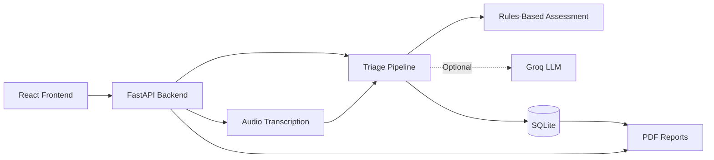

# MedTriage AI — Team Alpha 2.0

**HackIndia AI & CyberTech Hackathon 2026 · KIT Kanpur**

Hackathon team repository: [Alpha 2.0](https://github.com/HackIndiaXYZ/hackindia-ai-cybertech-hackathon-2026-alpha-20)

MedTriage AI is an AI-assisted triage support and clinical documentation prototype. It provides text and audio symptom intake, a transparent rules engine, optional Groq LLM/Whisper integration, a synthetic patient queue backed by SQLite, and PDF reports.

> **Safety disclaimer:** This is a hackathon prototype, not a medical device. It is not clinically validated and does not provide a diagnosis or replace healthcare professionals. Use synthetic data only. No regulatory or healthcare privacy compliance is claimed.

## Features

* Text-based symptom intake and structured summaries
* Audio transcription through the configured speech-to-text provider
* Transparent rules-based urgency assessment
* Optional AI-assisted summaries
* Synthetic patient history and clinic queue
* Downloadable PDF reports
* Visible safety disclaimers and emergency guidance

## Architecture



Without an API key, supported text triage functions can run in rules-only mode. Audio transcription requires a configured speech-to-text provider.

## Technology stack

* **Frontend:** React, Vite
* **Backend:** Python, FastAPI
* **Storage:** SQLite
* **AI and transcription:** Optional Groq integrations
* **Reports:** PDF generation
* **Testing:** pytest

## Quick start (Windows)

From the project root:

```bat
setup.bat
```

Configure your local `.env` file if you want to enable optional AI and audio features. Never commit `.env` or publish API keys.

Start the application:

```bat
start_all.bat
```

Default local addresses:

* Frontend: http://127.0.0.1:5173
* Backend: http://127.0.0.1:8000
* API documentation: http://127.0.0.1:8000/docs
* Health endpoint: http://127.0.0.1:8000/health

### Manual setup

Create and activate a Python virtual environment, install `requirements.txt`, and run the FastAPI application. In `frontend/`, install the npm dependencies and start the Vite development server.

```bat
python -m venv venv
venv\Scripts\activate
python -m pip install -r requirements.txt
python -m uvicorn app.main:app --reload
```

In a second terminal:

```bat
cd frontend
npm install
npm run dev
```

## Configuration

Optional backend settings are documented in `.env.example`. These may include the AI provider key, model identifiers, transcription provider, timeout settings, database path, CORS origins, and report settings.

Keep actual credentials in `.env` locally. Never place API keys in frontend variables or source code.

## Demo scenarios

Use fictional or synthetic examples only.

| Scenario                | External API key                              |
| ----------------------- | --------------------------------------------- |
| Health endpoint         | Not required                                  |
| Rules-only text triage  | Not required                                  |
| AI-assisted summary     | Required                                      |
| Audio transcription     | Requires a configured speech-to-text provider |
| Synthetic patient queue | Not required                                  |
| PDF report generation   | Not required                                  |

## Testing

Run the automated backend tests with:

```bat
python -m pytest -q
```

Build the frontend with:

```bat
cd frontend
npm install
npm run build
```

Only report test results that have actually been run in the current project environment.

## Documentation

Additional documentation is available in `docs/`:

* `ARCHITECTURE.md`
* `API_GUIDE.md`
* `AI_PIPELINE.md`
* `TESTING.md`
* `DEMO_SCRIPT.md`
* `SAFETY_AND_LIMITATIONS.md`
* `SUBMISSION_CHECKLIST.md`

## Limitations

This prototype has not been clinically validated. Rules-based urgency categories and AI-generated summaries may be incomplete or incorrect. The output is intended to demonstrate a technical workflow, not to direct treatment decisions. Healthcare professionals must independently assess patients and use appropriate emergency services when needed.
