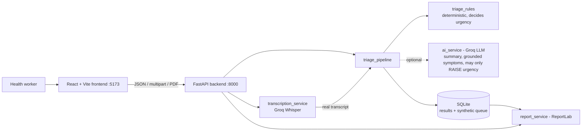

# Architecture

## Frontend (`frontend/`)
React 18 + Vite, no UI or router dependencies. Hash routes: `#/dashboard`, `#/new`, `#/cases[/id]`, `#/queue`, `#/about`.
All HTTP lives in `src/api.js` (base URL from `VITE_API_BASE_URL`; JSON via `fetch`; audio via `XMLHttpRequest` for upload progress, browser-set
multipart boundary; PDF fetched as a blob and checked for the `%PDF-` signature). Dashboard numbers are computed from `GET /api/v1/triage` and
`GET /api/v1/patients`; nothing is hardcoded. `/health` is polled every 15 s and drives the connectivity indicator and the voice limits.
## Backend (`app/`)
Routes in `app/api/*` are thin; logic is in `app/services/*` (see `docs/AI_PIPELINE.md`). Settings via environment / `.env` (`app/config.py`).
## Data flow (voice)
Upload/record -> client checks type and size -> multipart POST -> server validates size, extension, MIME, signature -> Groq Whisper -> transcript ->
same pipeline as text (rules, optional LLM) -> stored in SQLite -> response -> UI shows transcript + result -> PDF built from the stored record.
## Services that must run during a demo
Backend (`start_backend.bat`) and frontend (`start_frontend.bat`). Internet is needed only for AI/voice (Groq); the dashboard, rules-only text
triage, queue and PDFs work offline.
